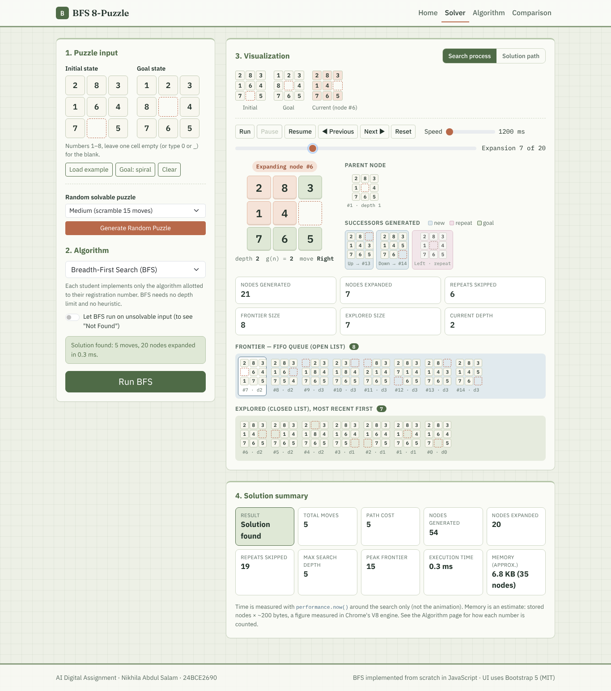
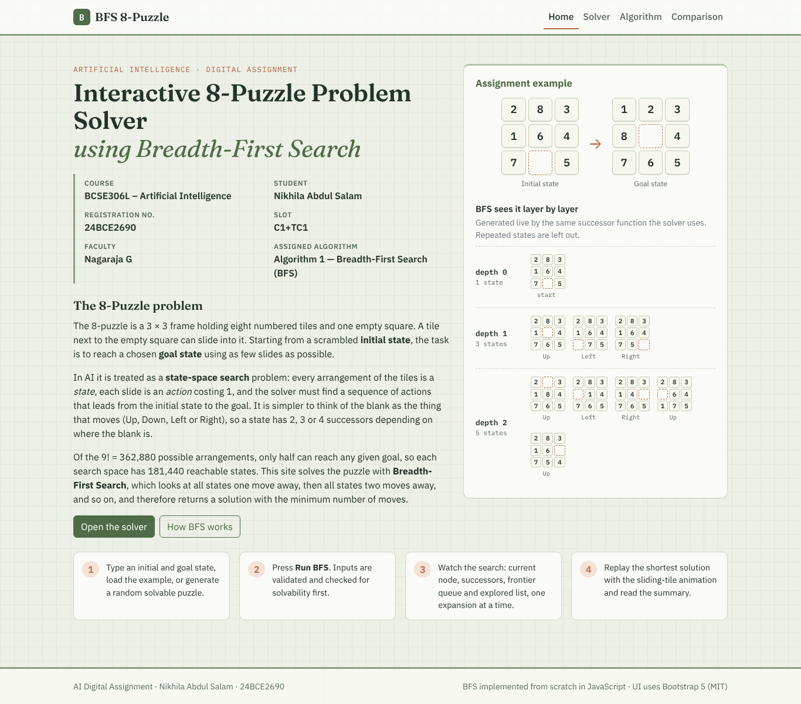
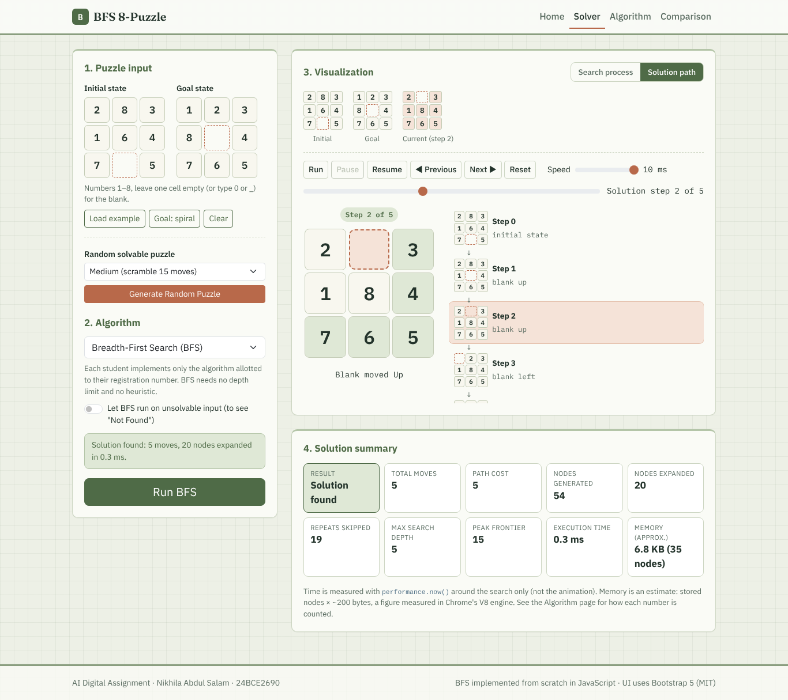
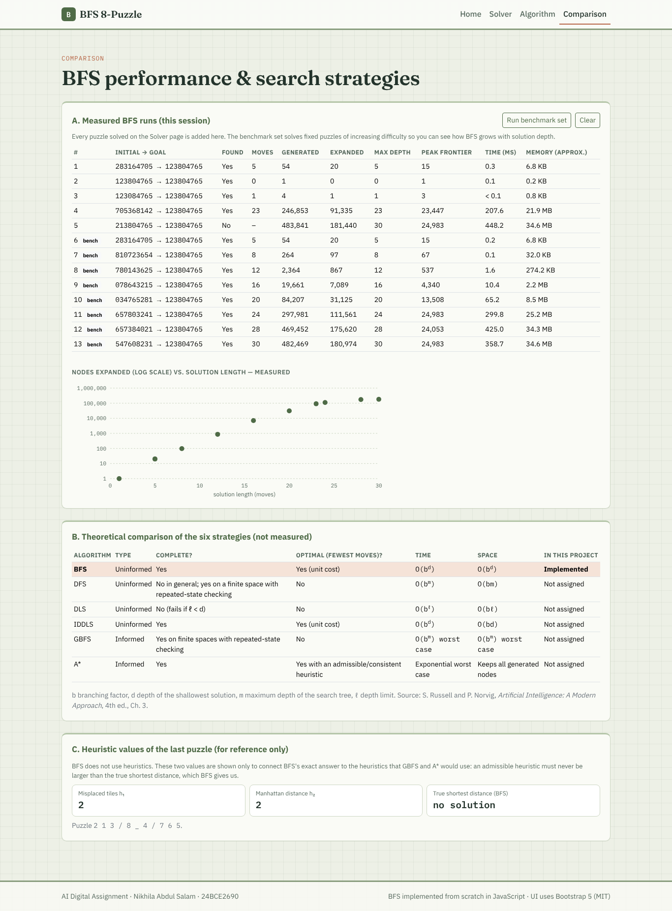
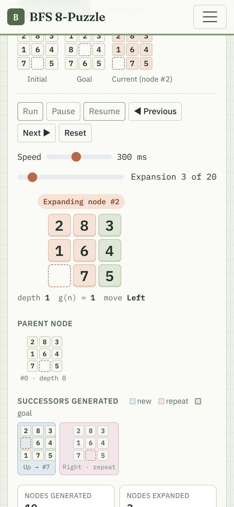

# Interactive 8-Puzzle Solver using Breadth-First Search

An interactive web application that solves the 8-puzzle with **Breadth-First Search (BFS)**, implemented from scratch in plain JavaScript, and shows the search step by step: the node being expanded, its successors, the FIFO frontier, the explored list, and finally the shortest solution with sliding-tile animation.

| | |
|---|---|
| **Course** | BCSE306L – Artificial Intelligence (Digital Assignment / Case Study) |
| **School** | School of Computer Science and Engineering (SCOPE), VIT Vellore |
| **Assignment** | Interactive 8-Puzzle Problem Solver using AI Search Algorithms |
| **Student** | Nikhila Abdul Salam |
| **Registration No.** | 24BCE2690 |
| **Slot** | C1+TC1 |
| **Faculty** | Nagaraja G |
| **Assigned algorithm** | Algorithm 1 – Breadth-First Search (BFS) |
| **Live website** | `https://<your-username>.github.io/AI-8Puzzle-Visualizer/` |
| **Repository** | `https://github.com/<your-username>/AI-8Puzzle-Visualizer` |
| **Demo video** | `[link to your 3–5 minute video]` |



---

## Objective

To model the 8-puzzle as a state-space search problem, implement BFS without any search library, and build a visual tool that shows *how* BFS explores states level by level and why it returns a minimum-move solution.

**Scope.** The assignment allots one algorithm per registration number, and 24BCE2690 is allotted Algorithm 1 (BFS). Only BFS is implemented. The other algorithms appear in the algorithm selector as disabled ("not assigned") and in a clearly labelled *theoretical* comparison table. No results for other algorithms are measured or invented.

## Technologies used

| Technology | Use |
|---|---|
| HTML5 | Page structure (single page with four sections) |
| CSS3 | Custom sage-green theme, tile animation (`transform` + `transition`) |
| JavaScript (ES6) | Puzzle model, BFS, visualization and controls – no frameworks |
| Bootstrap 5.3.8 | Grid, navbar, forms, tables (stored in `assets/vendor/bootstrap/`, MIT licence) |
| Fraunces, IBM Plex Sans / Mono | Fonts stored in `assets/vendor/fonts/` (SIL Open Font Licence), so no internet is needed |
| GitHub Pages | Static hosting – no backend, no API keys |

## Features

- **Home** – course, assignment title, student details, introduction to the 8-puzzle, and a live picture of BFS layers 0–2 for the example puzzle.
- **Puzzle input** – type the initial and goal states in 3×3 grids (blank = empty cell, `0` or `_`), load the assignment example, switch between two goal layouts, or **Generate Random Puzzle** (easy / medium / hard scramble, or any solvable arrangement).
- **Validation** – rejects wrong characters, duplicate or missing tiles, and more or fewer than one blank, with a specific message.
- **Solvability check** – inversion-parity test before searching; unsolvable puzzles are explained instead of searched. An optional switch lets BFS run anyway to demonstrate the *Not Found* case (it exhausts all 181,440 reachable states).
- **Search process view** – for every expansion: current node, depth and g(n), move used, parent node, generated successors marked *new / repeat / goal*, frontier queue (open list), explored list (closed list), and live counters.
- **Solution path view** – animated sliding tiles and the full list *Step 0 ↓ Step 1 ↓ …*, clickable.
- **Controls** – Run, Pause, Resume, Next Step, Previous Step, Reset, speed slider (1200 ms – 10 ms) and a step scrubber.
- **Solution summary** – found / not found, moves, path cost, nodes generated, nodes expanded, repeats skipped, maximum depth, peak frontier, execution time, approximate memory.
- **Comparison page** – table of measured BFS runs (plus a one-click benchmark set of fixed puzzles from 5 to 30 moves) with a log-scale growth chart; theoretical comparison of the six strategies; heuristic values of the last puzzle for reference.
- **Algorithm page** – description, working principle, pseudocode, counting rules, completeness, optimality, time/space complexity, advantages, limitations, optimality argument and solvability proof.
- Responsive layout (tested at 1366 px and 390 px wide).

## How BFS is implemented

`js/bfs.js` uses three structures:

1. **`nodes`** – an array of every stored node `{ state, parent, move, depth }`, in the order nodes were added. `parent` is the index of the parent node.
2. **`head`** – index of the next node to expand. `nodes[head …]` is the **FIFO frontier**: children are pushed at the back, BFS reads from the front with `head++` (O(1), unlike `Array.shift()`). `nodes[0 … head-1]` is the **explored** list.
3. **`visited`** – a `Map` from state string to node index. A state is added when first generated, so no board is queued twice.

States are 9-character strings read row by row with `0` for the blank (e.g. `"283164705"`). Successors are produced by moving the blank **Up, Down, Left, Right** (in that order) when the move stays on the board. The goal test is applied when a node is generated (early goal test). When the goal is found, the path is rebuilt by following `parent` indexes back to the start.

```text
BFS(start, goal)
  nodes ← [node(start)];  visited ← {start}
  if start = goal: return [start]
  head ← 0
  while head < length(nodes):
      current ← nodes[head]; head ← head + 1            // dequeue
      for each (state, move) in SUCCESSORS(current):
          if state in visited: continue                // repeated state
          append node(state, parent=current, depth+1) to nodes; add to visited
          if state = goal: return PATH(new node)
  return failure
```

The visualizer does **not** re-run the search. Because BFS expands nodes in exactly the order it stored them, expansion *k* is `nodes[k]`, the explored list after it is `nodes[0..k]`, and the frontier is `nodes[k+1 .. queueEnd_k − 1]`. BFS records only `queueEnd` and two counters per expansion, which is enough to replay every step forwards and backwards.

### Heuristics used

BFS is uninformed and uses **no heuristic**. The comparison page displays the *Misplaced Tiles* and *Manhattan Distance* values of the last puzzle only for reference, next to BFS's exact shortest distance (both heuristics are always ≤ that distance).

### Counting conventions

| Statistic | Meaning |
|---|---|
| Nodes generated | Start node + every successor created by a legal move, **including** repeats that were skipped |
| Nodes expanded | Nodes removed from the front of the queue whose successors were generated (the goal is never expanded) |
| Repeats skipped | Generated successors already in `visited` |
| Frontier / Explored | Nodes waiting in the queue / nodes already expanded |
| Max search depth | Depth of the deepest node generated |
| Path cost | Number of moves (each move costs 1) |
| Execution time | `performance.now()` around the search only, not the animation. Browsers round this timer (often to 0.1 ms), so tiny searches show "< 0.1 ms" |
| Memory (approx.) | Stored nodes × 200 bytes. The 200 B figure was measured in V8 (Node 22) with `tests/measure-memory.js` (≈199 B per node incl. the `Map` entry). It is an estimate, not a browser reading |

## Complexity

With branching factor *b* and depth of the shallowest solution *d*: time **O(b<sup>d</sup>)**, space **O(b<sup>d</sup>)**. BFS is **complete** (finite branching) and **optimal** here because every move costs 1. For the 8-puzzle *b* is 2, 3 or 4 depending on the blank's position, and duplicate removal caps the search at the 9!/2 = 181,440 states that can reach the goal.

Measured with the benchmark set (goal `1 2 3 / 8 _ 4 / 7 6 5`, headless Chrome 141 on a cloud Linux VM, median of 3 runs – your own machine will give different times):

| Moves | Generated | Expanded | Stored | Peak frontier | Time (ms) | Memory (approx.) |
|---:|---:|---:|---:|---:|---:|---:|
| 5 | 54 | 20 | 35 | 15 | < 0.1 | 6.8 KB |
| 8 | 264 | 97 | 164 | 67 | 0.1 | 32 KB |
| 12 | 2,364 | 867 | 1,404 | 537 | 0.8 | 274 KB |
| 16 | 19,661 | 7,089 | 11,429 | 4,340 | 5.8 | 2.2 MB |
| 20 | 84,207 | 31,125 | 44,633 | 13,508 | 33.6 | 8.5 MB |
| 24 | 297,981 | 111,561 | 132,353 | 24,983 | 178.7 | 25.2 MB |
| 28 | 469,452 | 175,620 | 180,075 | 24,053 | 275.4 | 34.3 MB |
| 30 | 482,469 | 180,974 | 181,382 | 24,983 | 274.1 | 34.6 MB |

Nodes expanded grow by roughly 4–9× between consecutive benchmark puzzles up to 24 moves, then flatten because BFS approaches the size of the whole reachable state space (181,440). Memory follows the stored-node count, which is why BFS's space use, not its time, is usually the first limit.

## Project structure

```text
AI-8Puzzle-Visualizer/
├── index.html                 # all four pages (Home, Solver, Algorithm, Comparison)
├── css/
│   └── style.css              # theme, boards, tile animation, responsive rules
├── js/
│   ├── puzzle.js              # state format, successors, validation, solvability, random puzzles, heuristics
│   ├── bfs.js                 # BFS implementation + describeStep() used for replay
│   ├── visualization.js       # board drawing, animated board, Player (run/pause/next/prev)
│   └── app.js                 # page navigation, inputs, wiring, summary, comparison page
├── assets/
│   ├── images/                # favicon and screenshots used in this README
│   └── vendor/
│       ├── bootstrap/         # Bootstrap 5.3.8 CSS/JS + LICENSE
│       └── fonts/             # Fraunces + IBM Plex (woff2) + licences
├── tests/
│   ├── bfs.test.js            # 30 automated checks (node tests/bfs.test.js)
│   └── measure-memory.js      # bytes-per-node measurement (node --expose-gc ...)
├── docs/
│   ├── project-report.docx    # academic report (editable Word file)
│   └── testing.md             # full test plan and results
└── README.md
```

Scripts are loaded in the order `puzzle.js → bfs.js → visualization.js → app.js` as ordinary `<script>` tags, so the site works by simply opening `index.html` – no build step or server needed.

## How to run

**Online:** open the GitHub Pages link above.

**Locally:**
1. Download or clone the repository.
2. Double-click `index.html` (Chrome, Edge or Firefox).
   *Optional:* in VS Code, right-click `index.html` → *Open with Live Server*, or run `python -m http.server` in the folder and open `http://localhost:8000`.

**Example to try:** press *Load example* (initial `2 8 3 / 1 6 4 / 7 _ 5`, goal `1 2 3 / 8 _ 4 / 7 6 5`) and *Run BFS*. Expected result: 5 moves (blank Up, Up, Left, Down, Right), 54 nodes generated, 20 expanded.

**Automated tests** (needs Node.js 16+; not needed for the website):

```bash
node tests/bfs.test.js
node --expose-gc tests/measure-memory.js
```

## Testing

Full test table: [`docs/testing.md`](docs/testing.md). `tests/bfs.test.js` – 30 checks, all passing on 22 Oct 2026 (Node 22):

- initial = goal (0 moves, 1 generated, 0 expanded); one-move puzzle; assignment example (5 moves);
- invalid input: duplicate tile, missing tile, two blanks, `9`, letters, wrong length;
- unsolvable input: rejected by the parity check; if searched anyway BFS stores exactly 181,440 states and reports not found;
- 150 random solvable puzzles: every consecutive pair of states differs by one legal blank move, and BFS length equals the true shortest distance from an independently computed table of all 181,440 states (max 31, matching the known hardest instance);
- 25 small puzzles cross-checked by brute-force depth-limited search (no shorter path exists);
- consistency of the recorded trace used for replay.

The user interface was tested in headless Chromium (39 scripted checks): navigation, validation messages, run/pause/resume/next/previous/reset/speed/scrubber, automatic switch to the solution view, path-list clicks, *Not Found* case, benchmark table and chart, and no horizontal scrolling at 390 px width.

## Screenshots

| Home | Solution path |
|---|---|
|  |  |
| **Comparison** | **Mobile (390 px)** |
|  |  |

## Known limitations

- Only BFS is implemented (as allotted); other algorithms are described, not run.
- The search runs on the main thread. The worst case (about 181,000 expansions) takes a few hundred milliseconds, during which the page does not respond.
- Replaying a very large search one expansion at a time is slow even at 10 ms per step; use the scrubber or the *Solution path* tab.
- Execution time depends on the computer and browser; memory is an estimate from a fixed bytes-per-node figure.
- Run history on the comparison page is kept only until the page is reloaded.

## References

1. S. Russell and P. Norvig, *Artificial Intelligence: A Modern Approach*, 4th ed. Pearson, 2020 – Ch. 3 (problem formulation, BFS, comparison of search strategies, 8-puzzle heuristics).
2. T. H. Cormen, C. E. Leiserson, R. L. Rivest and C. Stein, *Introduction to Algorithms*, 4th ed. MIT Press, 2022 – Breadth-first search.
3. W. W. Johnson and W. E. Story, "Notes on the '15' puzzle," *American Journal of Mathematics*, vol. 2, no. 4, pp. 397–404, 1879 – solvability (parity).
4. A. Reinefeld, "Complete solution of the eight-puzzle and the benefit of node ordering in IDA*," in *Proc. 13th Int. Joint Conf. on Artificial Intelligence (IJCAI-93)*, 1993, pp. 248–253 – complete analysis of the 8-puzzle state space.
5. MDN Web Docs, "Performance: now() method." https://developer.mozilla.org/en-US/docs/Web/API/Performance/now
6. Bootstrap, "Get started with Bootstrap" (v5.3). https://getbootstrap.com/docs/5.3/getting-started/introduction/
7. GitHub Docs, "Creating a GitHub Pages site." https://docs.github.com/en/pages/getting-started-with-github-pages/creating-a-github-pages-site

## Third-party resources and licences

- **Bootstrap 5.3.8** – © The Bootstrap Authors, MIT licence (copy in `assets/vendor/bootstrap/LICENSE`).
- **Fraunces** (© The Fraunces Project Authors) and **IBM Plex Sans / Mono** (© IBM Corp.) – SIL Open Font Licence 1.1, font files taken from the Fontsource packages; licences in `assets/vendor/fonts/`.
- All other code, the favicon and the screenshots were created for this project. No search or puzzle-solving library is used.
- AI assistance: `[state here, if your course requires it, how you used AI tools while building this project]`

---
*Submitted by Nikhila Abdul Salam (24BCE2690) for the Artificial Intelligence digital assignment.*
